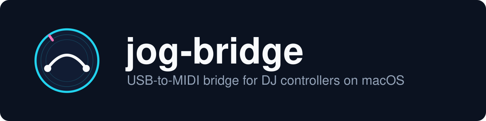

<p align="center">
  
</p>

<p align="center">
  <a href="https://github.com/ffurlanetto/jog-bridge/releases"></a>
  <a href="https://github.com/ffurlanetto/jog-bridge/actions/workflows/ci.yml"></a>
  <a href="LICENSE"></a>
  
  
</p>

# jog-bridge

**Use your Hercules DJ Control MP3 e2 on a modern Mac — no manufacturer driver needed.**

Install jog-bridge, plug in the console, open djay, rekordbox, Serato or Mixxx: the console shows
up as a MIDI controller called **"Hercules MP3 e2"**, and its LEDs follow the software. It starts
by itself at login and runs quietly in the background.

> **jog-bridge is an independent project, not affiliated with Guillemot Corporation or Hercules,
> and neither approved nor sponsored by them.** The USB protocol was established by reverse
> engineering (see [Credits](#credits) and [Trademarks](#trademarks)).

## Quick install

1. **Download** the latest `jog-bridge-<version>.pkg` from the
   [Releases page](https://github.com/ffurlanetto/jog-bridge/releases).
2. **Open it.** The package is not signed, so macOS blocks it the first time: click **Done** (not
   *Move to Bin*), then *System Settings → Privacy & Security* → **Open Anyway**.
   [More on Gatekeeper](docs/troubleshooting.md#gatekeeper-blocks-the-pkg).
3. **Allow it in the background**: *System Settings → General → Login Items & Extensions*, enable
   **Jog Bridge**.
4. **Plug in the console** and pick **"Hercules MP3 e2"** (input and output) in your DJ software's
   MIDI settings.

Not working? Open **Jog Bridge** from `/Applications`: the [status panel](#the-status-panel) tells
you what is wrong and offers the fix.

## Compatibility

| | Status |
|---|---|
| **Hercules DJ Control MP3 e2** (`06F8:B105`) | ✅ Tested |
| Other Hercules models (MP3 LE, Glow…) | ❓ Untested — [help us test](#other-hercules-controllers) |
| macOS 13 Ventura or later | ✅ Required |
| Apple Silicon Macs | ✅ Tested |
| Intel Macs | ❓ Untested |
| djay | ✅ Ready-made mapping included |
| rekordbox, Serato, Mixxx, any CoreMIDI app | Works through MIDI Learn (no mapping shipped) |

## Features

- Buttons → MIDI notes, knobs / faders / encoders → Control Change.
- LEDs driven from the DJ application (steady and blinking).
- Automatic reconnection when the console is plugged or unplugged.
- Automatic start at login (LaunchAgent).
- A status panel: click **Jog Bridge** in `/Applications` to see at a glance whether the bridge
  is running, and get help when it is not.
- Self-contained binary: libusb is statically linked.
- Ready-made djay mapping: [`Hercules MP3 e2.djayMidiMapping`](Hercules%20MP3%20e2.djayMidiMapping).

## The status panel

Open **Jog Bridge** from `/Applications` (Spotlight or the Finder). A small window shows whether
everything is working:

- 🟢 **Jog Bridge is running** — the service is up, allowed in the background, the MIDI ports are
  published and the console is connected.
- 🟠 **Attention** — for example *Waiting for the console* (plug it in), or *Another app is using
  the console* (close other DJ software or an old Hercules driver).
- 🔴 **Problem** — the service is stopped, not loaded, or not allowed in *Login Items &
  Extensions*. The panel offers the matching button: **Start**, **Restart** or **Open Login Items
  Settings**.

Under *Details*, **Show Log** opens `/tmp/jog-bridge.log` and **Copy Diagnostics** puts a report
on the clipboard, ready to paste into an issue. Closing the window quits the panel only; the
bridge keeps running in the background. See
[ADR 0012](docs/adr/0012-status-panel-in-the-bundle.md).

## In your DJ software

Select the "Hercules MP3 e2" controller (input and output) in the MIDI settings, then either use
the shipped djay mapping or **MIDI Learn** to bind each button. The port identifiers are fixed:
the mapping is kept from one session to the next. The full table of notes and CCs is in
[docs/midi-mapping.md](docs/midi-mapping.md).

## Other Hercules controllers?

Only the MP3 e2 has been tested, but other models of the same family may work with the `--pid`
option. If you own one, [open a "New hardware" issue](https://github.com/ffurlanetto/jog-bridge/issues/new?template=hardware_support.md)
with the output of `jog-bridge --list`: it is the fastest way to get your console supported.

## FAQ

**Why not the official Hercules driver?**
jog-bridge does not need it: it talks to the console directly from user space, with no kernel
extension and no DriverKit. If an old Hercules driver is still installed, uninstall it — it takes
over the console's USB interface and the bridge cannot claim it.

**Do I need administrator rights?**
Only to install the package. At runtime the bridge runs as your user.

**Does it work on Intel Macs?**
Probably, but it has only been tested on Apple Silicon. Reports are welcome.

**Does it work on iPad?**
No. iPadOS does not allow this kind of USB access without a DriverKit extension that Apple has to
approve: see [ADR 0002](docs/adr/0002-userspace-usb-access-with-libusb.md).

<a id="2-build"></a>

## Build from source

### Prerequisites

```sh
xcode-select --install          # Swift build tools
brew install libusb pkg-config
```

macOS 13 or later. Homebrew is only needed on the machine that builds.

### Build

```sh
swift build -c release
```

The binary is in `.build/release/jog-bridge`.

### Check the console (first time)

Plug in the console, then:

```sh
.build/release/jog-bridge --list
```

A `06F8:B105` device is expected. On an MP3 e2, interface 0 exposes a **bulk IN endpoint
`0x81`** (the one that carries the state frames); interface 1 exposes `0x82` / `0x03`, which are
unusable as is (see the [USB protocol](docs/usb-protocol.md)). The bridge detects the endpoint
by itself; if detection gets it wrong, force it with `--in 0x81`.

Then test live:

```sh
.build/release/jog-bridge --dump
```

Move the crossfader, press Play: every action prints the bytes that changed in the USB frame and
the matching MIDI message. **Ctrl-C** to stop.

For an independent check, macOS's *Audio MIDI Setup* utility (Window → Show MIDI Studio) must
show the "Hercules MP3 e2" port while the bridge is running.

### Build and install the package

```sh
./scripts/build-pkg.sh 1.0.0        # produces dist/jog-bridge-1.0.0.pkg
open dist/jog-bridge-1.0.0.pkg
```

A package you build yourself carries no quarantine attribute and opens without a Gatekeeper
warning. From the command line:

```sh
sudo installer -pkg dist/jog-bridge-1.0.0.pkg -target /
```

The installation puts the app bundle `Jog Bridge.app` in `/Applications/`, installs the
LaunchAgent in `~/Library/LaunchAgents/` and starts it immediately. The bundle gives the item a
proper name ("Jog Bridge") and icon in *System Settings → Login Items & Extensions*
([ADR 0011](docs/adr/0011-app-bundle-for-the-launch-agent.md)); no loose binary is installed in
`/usr/local/bin`.

Check that the service is running:

```sh
launchctl print gui/$(id -u)/local.jog-bridge | grep -E "state|pid|runs|last exit"
tail -f /tmp/jog-bridge.log
```

## Command-line options

| Option | Purpose |
|---|---|
| `--list` | List Hercules devices and their endpoints |
| `--dump` | Print console state changes and the MIDI messages exchanged |
| `--name <name>` | Rename the virtual MIDI ports |
| `--pid <hex>` | Another product ID (MP3 LE, Glow…) — untested |
| `--interface <n>` | USB interface (default 0) |
| `--in <hex>` | Force the input endpoint (e.g. `0x81`) |
| `--help` | Show the help |

<details>
<summary><strong>Running the installed binary</strong></summary>

The executable lives inside the bundle, so it is not on your `PATH`. To use `--list` or `--dump`
on an installed copy, call it by its full path (stop the agent first for `--dump`, which needs
the console to itself):

```sh
JOG="/Applications/Jog Bridge.app/Contents/MacOS/jog-bridge"
"$JOG" --list
launchctl bootout gui/$(id -u)/local.jog-bridge && "$JOG" --dump
```

Everywhere else in this documentation, `jog-bridge` stands for that executable (or for
`.build/release/jog-bridge` in a checkout). If you want a short command, add an alias to your
shell profile: `alias jog-bridge='/Applications/Jog Bridge.app/Contents/MacOS/jog-bridge'`.

</details>

<details>
<summary><strong>Uninstall</strong></summary>

```sh
launchctl bootout gui/$(id -u)/local.jog-bridge
rm ~/Library/LaunchAgents/local.jog-bridge.plist
sudo rm -rf "/Applications/Jog Bridge.app"
sudo pkgutil --forget local.jog-bridge
```

(An early build also installed `/usr/local/bin/jog-bridge`; the installer removes it, and you can
delete it by hand if you installed that build and never upgraded.)

</details>

## Troubleshooting

- **The agent does not start after installation** (`Bootstrap failed: 5: Input/output error`):
  open **Jog Bridge** — the panel says why and offers the fix. Usually the item is not allowed in
  *Login Items & Extensions* yet; enable it, then log out and back in
  ([details](docs/troubleshooting.md#the-agent-does-not-start-bootstrap-failed-5-inputoutput-error)).
- **"Cannot claim interface"**: a Hercules driver is still installed, or another application
  (Mixxx) already holds the console. Close it.
- **Nothing in `--dump`**: check the endpoint with `--list`, try `--in 0x81`.

More details in [docs/troubleshooting.md](docs/troubleshooting.md).

## How it works

The console is not a standard MIDI device: it exposes a "vendor specific" USB interface
(class `0xFF`) and continuously sends 38-byte state frames on a bulk endpoint. This small daemon
reads those frames with libusb, converts them to MIDI messages and publishes them on a
**virtual MIDI port "Hercules MP3 e2"** visible to any application. The reverse direction works
too: MIDI messages sent back by the application light the console's LEDs.

No kernel extension, no DriverKit, no administrator rights at runtime. See the
[architecture](docs/architecture.md) and the [USB protocol](docs/usb-protocol.md).

## Documentation

- [Architecture](docs/architecture.md)
- [USB protocol](docs/usb-protocol.md)
- [MIDI and LED mapping](docs/midi-mapping.md)
- [Development](docs/development.md) · [Tests](docs/testing.md)
- [Troubleshooting](docs/troubleshooting.md)
- [Identity and trademarks](docs/branding.md)
- [Architecture decisions (ADR)](docs/adr/README.md)
- [Contributing](CONTRIBUTING.md) · [Changelog](CHANGELOG.md) · [Security](SECURITY.md)

## Credits

The initialisation sequence and the LED table come from the reverse-engineering work of
[foomatic/djcontrol](https://github.com/foomatic/djcontrol) (`Protocol.txt`, `djcontrol.py`).

## Trademarks

Hercules is a trademark of Guillemot Corporation. djay, rekordbox, Serato, Mixxx, macOS,
CoreMIDI and the other names cited belong to their respective owners. They are only used to
indicate compatibility ("works with"): this project has no connection with those companies.
jog-bridge's visual elements (`assets/branding/`) are original and reuse no third-party logo.
See [docs/branding.md](docs/branding.md).

## Licences

Project code: [MIT](LICENSE).

The binary distributed in the `.pkg` embeds [libusb](https://libusb.info), under the
**LGPL 2.1**, statically linked. Since the project's source code and build scripts are public,
the binary can be relinked with another version of libusb (see
[ADR 0004](docs/adr/0004-static-linking-of-libusb.md)).
