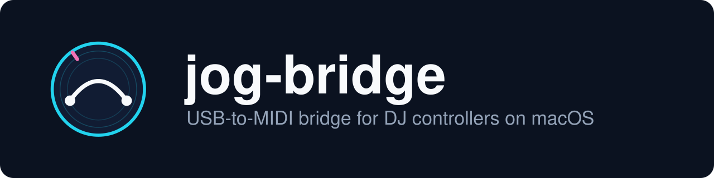

<p align="center">
  
</p>

<p align="center">
  <a href="https://github.com/ffurlanetto/jog-bridge/actions/workflows/ci.yml"></a>
  <a href="LICENSE"></a>
  
  
</p>

# jog-bridge

**USB-to-MIDI bridge for DJ controllers on macOS.** Plug in the console, open your DJ software:
it shows up as a MIDI device, LEDs included.

Today, **jog-bridge** supports the **Hercules DJ Control MP3 e2**.

The console is not a standard MIDI device: it exposes a "vendor specific" USB interface
(class `0xFF`) and continuously sends 38-byte state frames on a bulk endpoint. This small daemon
reads those frames with libusb, converts them to MIDI messages and publishes them on a
**virtual MIDI port "Hercules MP3 e2"** visible to any application (djay, rekordbox, Serato…).
The reverse direction works too: MIDI messages sent back by the application light the console's
LEDs.

No kernel extension, no DriverKit, no administrator rights at runtime.

> **jog-bridge is an independent project, not affiliated with Guillemot Corporation or Hercules,
> and neither approved nor sponsored by them.** The USB protocol was established by reverse
> engineering (see [Credits](#credits) and [Trademarks](#trademarks)).

## Features

- Buttons → MIDI notes, knobs / faders / encoders → Control Change.
- LEDs driven from the DJ application (steady and blinking).
- Automatic reconnection when the console is plugged or unplugged.
- Automatic start at login (LaunchAgent).
- Self-contained binary: libusb is statically linked.
- Ready-made djay mapping: [`Hercules MP3 e2.djayMidiMapping`](Hercules%20MP3%20e2.djayMidiMapping).

## 1. Prerequisites

```sh
xcode-select --install          # Swift build tools
brew install libusb pkg-config
```

macOS 12 or later. Homebrew is only needed on the machine that builds.

> If an old Hercules driver was installed on this Mac, uninstall it: it takes over the USB
> interface and the bridge will not be able to claim it.

## 2. Build

```sh
swift build -c release
```

The binary is in `.build/release/jog-bridge`.

## 3. Check the console (first time)

Plug in the console, then:

```sh
.build/release/jog-bridge --list
```

A `06F8:B105` device is expected. On an MP3 e2, interface 0 exposes a **bulk IN endpoint
`0x81`** (the one that carries the state frames); interface 1 exposes `0x82` / `0x03`, which are
unusable as is (see the [USB protocol](docs/usb-protocol.md)). The bridge detects the endpoint
by itself; if detection gets it wrong, force it with `--in 0x81`.

Then test live:

```sh
.build/release/jog-bridge --dump
```

Move the crossfader, press Play: every action prints the bytes that changed in the USB frame and
the matching MIDI message. **Ctrl-C** to stop.

For an independent check, macOS's *Audio MIDI Setup* utility (Window → Show MIDI Studio) must
show the "Hercules MP3 e2" port while the bridge is running.

## 4. Install for automatic start

### With the .pkg (recommended)

```sh
./scripts/build-pkg.sh 1.0.0        # produces dist/jog-bridge-1.0.0.pkg
open dist/jog-bridge-1.0.0.pkg
```

The `.pkg` is not signed with a Developer ID: Gatekeeper will block it on first double-click
("unidentified developer"). Right-click → *Open*, or *System Settings → Privacy & Security →
Open Anyway*.

The installation copies the binary to `/usr/local/bin/`, installs the LaunchAgent in
`~/Library/LaunchAgents/` and starts it immediately.

**Background permission.** On first start, macOS asks you to allow the `jog-bridge` item. Check
that it is enabled in *System Settings → General → Login Items & Extensions → Allow in the
Background*. As long as it is disabled, launchd refuses to load the agent
(`Bootstrap failed: 5: Input/output error`). Once enabled, log out and back in, or load the
agent by hand:

```sh
launchctl bootstrap gui/$(id -u) ~/Library/LaunchAgents/local.jog-bridge.plist
```

### Manually

```sh
sudo install -m 755 .build/release/jog-bridge /usr/local/bin/
cp local.jog-bridge.plist ~/Library/LaunchAgents/
launchctl bootstrap gui/$(id -u) ~/Library/LaunchAgents/local.jog-bridge.plist
```

Check that the service is running:

```sh
launchctl print gui/$(id -u)/local.jog-bridge | grep -E "state|pid|runs|last exit"
tail -f /tmp/jog-bridge.log
```

### Uninstall

```sh
launchctl bootout gui/$(id -u)/local.jog-bridge
rm ~/Library/LaunchAgents/local.jog-bridge.plist
sudo rm /usr/local/bin/jog-bridge
```

## 5. In the DJ software

Select the "Hercules MP3 e2" controller (input and output) in the MIDI settings, then either use
the shipped djay mapping or **MIDI Learn** to bind each button. The port identifiers are fixed:
the mapping is kept from one session to the next. The full table of notes and CCs is in
[docs/midi-mapping.md](docs/midi-mapping.md).

## Options

| Option | Purpose |
|---|---|
| `--list` | List Hercules devices and their endpoints |
| `--dump` | Print console state changes and the MIDI messages exchanged |
| `--name <name>` | Rename the virtual MIDI ports |
| `--pid <hex>` | Another product ID (MP3 LE, Glow…) — untested |
| `--interface <n>` | USB interface (default 0) |
| `--in <hex>` | Force the input endpoint (e.g. `0x81`) |
| `--help` | Show the help |

## Troubleshooting

- **"Cannot claim interface"**: a Hercules driver is still installed, or another application
  (Mixxx) already holds the console. Close it.
- **Nothing in `--dump`**: check the endpoint with `--list`, try `--in 0x81`.
- **The agent does not start after installation**: see the background permission above.

More details in [docs/troubleshooting.md](docs/troubleshooting.md).

## Documentation

- [Architecture](docs/architecture.md)
- [USB protocol](docs/usb-protocol.md)
- [MIDI and LED mapping](docs/midi-mapping.md)
- [Development](docs/development.md) · [Tests](docs/testing.md)
- [Troubleshooting](docs/troubleshooting.md)
- [Identity and trademarks](docs/branding.md)
- [Architecture decisions (ADR)](docs/adr/README.md)
- [Contributing](CONTRIBUTING.md) · [Changelog](CHANGELOG.md) · [Security](SECURITY.md)

## Limits

- macOS only. An iPadOS port is not possible as is: see
  [ADR 0002](docs/adr/0002-userspace-usb-access-with-libusb.md).
- Only the MP3 e2 (`06F8:B105`) has been tested.

## Credits

The initialisation sequence and the LED table come from the reverse-engineering work of
[foomatic/djcontrol](https://github.com/foomatic/djcontrol) (`Protocol.txt`, `djcontrol.py`).

## Trademarks

Hercules is a trademark of Guillemot Corporation. djay, rekordbox, Serato, Mixxx, macOS,
CoreMIDI and the other names cited belong to their respective owners. They are only used to
indicate compatibility ("works with"): this project has no connection with those companies.
jog-bridge's visual elements (`assets/branding/`) are original and reuse no third-party logo.
See [docs/branding.md](docs/branding.md).

## Licences

Project code: [MIT](LICENSE).

The binary distributed in the `.pkg` embeds [libusb](https://libusb.info), under the
**LGPL 2.1**, statically linked. Since the project's source code and build scripts are public,
the binary can be relinked with another version of libusb (see
[ADR 0004](docs/adr/0004-static-linking-of-libusb.md)).
